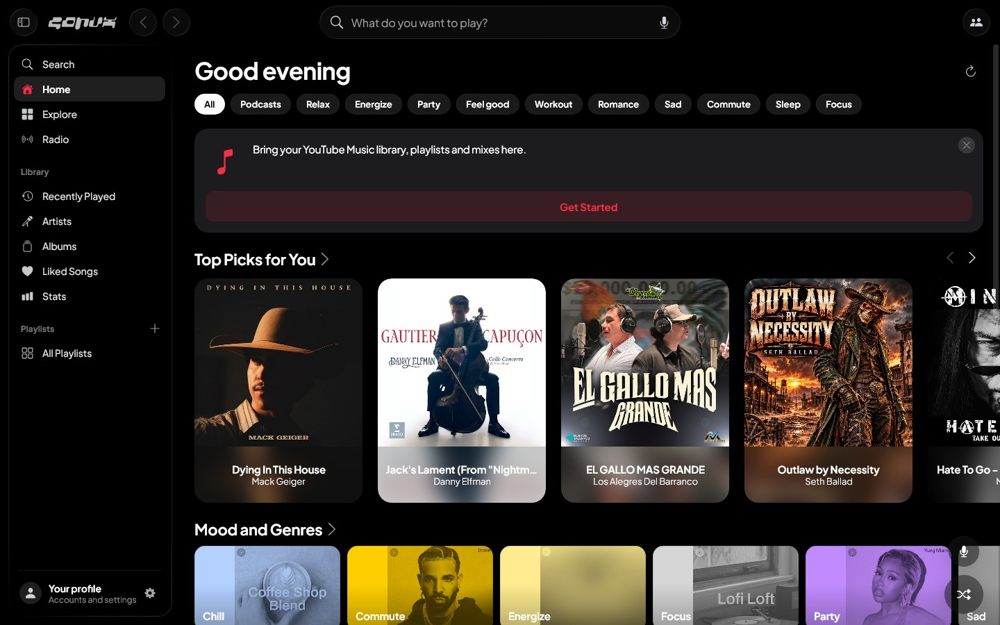
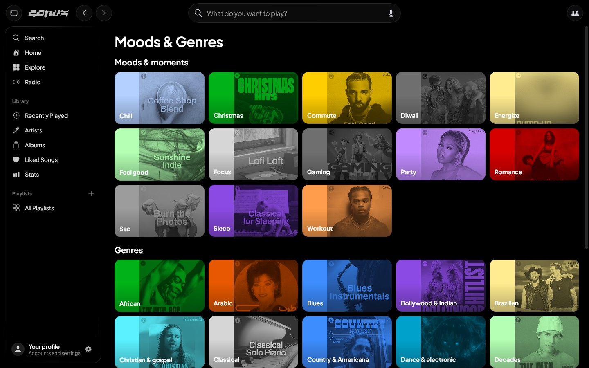
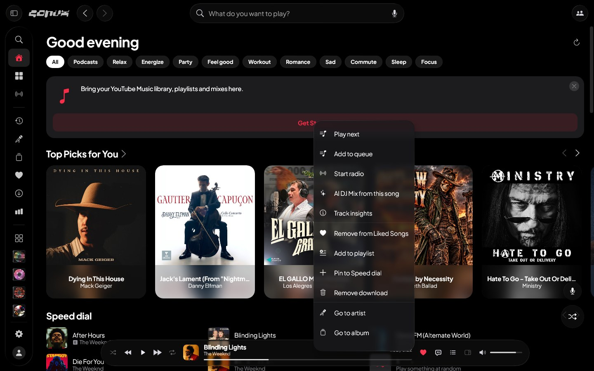
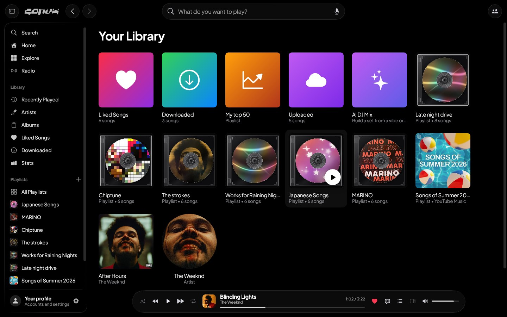
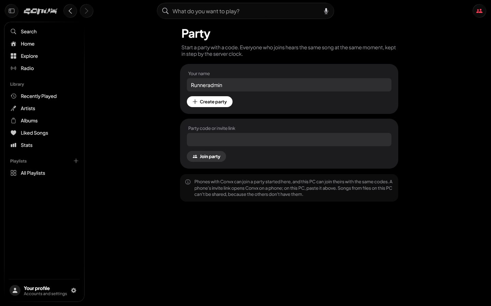
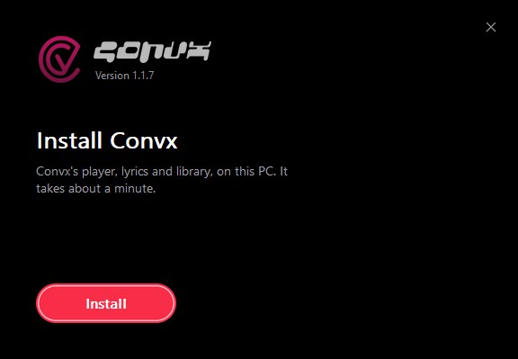

# Convx for Windows

The Windows version of [Convx](https://github.com/cosmictaserdev-creator/convx), the free music
app by [Aryan (Cosmic Taser)](https://github.com/cosmictaserdev-creator). Convx's author has made
this the official Windows version of Convx. It is maintained here by
[m33md](https://github.com/m33md), while Aryan keeps making the Android app.

It looks and works like the phone app, sized for a PC:

- Liquid glass on true black, in Convx's red, with a glass top bar, a simple side bar and a
  now-playing bar, and the phone's SF Symbols icons.
- Your YouTube Music account: Home, search, library, liked songs and playlists.
- The phone's lyrics styles, with word- and letter-synced lyrics.
- AutoMix transitions, an equalizer, Replay, and the AI features.
- Discord status, Last.fm and ListenBrainz scrobbling, and importing playlists from Spotify.
- Windows media keys and the taskbar's play controls.
- Disc Studio, a PC-only extra: design a CD or a vinyl record for any playlist, from layers of
  pictures, text, shapes, patterns, stickers (thousands of emoji and icons) and your own brush
  strokes, with effects like bloom, halftone and ink-brush texture, and share designs as
  `.convxdisc` files.

## Screenshots

| | |
|---|---|
|  |  |
| Home and the side bar | Moods & Genres |
|  |  |
| A song's menu, with the side bar folded | Your library, with the CD covers Convx draws for playlists |
|  |  |
| Listen Together | The setup |

## Download

**[Download the latest version](https://github.com/m33md/convx-desktop/releases/latest)** and run
`Convx-Setup-<version>.exe`.

If Windows says it protected your PC, click **More info**, then **Run anyway**. Convx updates
itself from the same page (Settings > Help & About > App updates).

You can also get an `.msi` installer, or a portable `.zip` that runs without installing, from the
same page.

## Build it yourself

You need JDK 21.

```
cd desktop
./gradlew run                 # start the app
./gradlew packageMsi          # Windows installer in build/compose/binaries/main/msi
```

Every push to `main` is built on GitHub Actions (`.github/workflows/desktop.yml`), and the
finished installers replace the ones on the
[latest release](https://github.com/m33md/convx-desktop/releases/latest).

## How it's made

It is written in Kotlin with Compose Multiplatform. It compiles the phone app's own YouTube Music,
lyrics, artwork and song recognition code, so both apps fetch music the same way. Audio is
decoded with FFmpeg.

| Path | What |
| --- | --- |
| `desktop/` | The Windows app |
| `innertube/`, `lyrics/`, `canvas/`, `integrations/` | Code from the Convx phone app: YouTube Music, lyrics, animated artwork and song recognition |
| `installer/windows/` | Convx's setup window (a WiX bundle around the app's MSI) |

The app keeps its data in two places on your PC:

| Path | What |
| --- | --- |
| `%APPDATA%\Convx` | Library (likes, playlists, history) and settings |
| `%LOCALAPPDATA%\Convx` | Song and artwork cache, logs |

## Credits

Convx, its design and its shared YouTube Music and lyrics code are by Aryan (Cosmic Taser). Get the
Android app, report phone bugs and join the community at
[cosmictaserdev-creator/convx](https://github.com/cosmictaserdev-creator/convx). The wordmark is
Aryan's, and the icons come from Aryan's
[SF Symbols for Compose](https://github.com/cosmictaserdev-creator/Jetpack_SF_Symbols) pack. Code
adapted from other open-source projects is listed in `NOTICE`.

## License

GPL-3.0, like Convx. This program is free software and comes with no warranty. See `LICENSE`
and `NOTICE` for the full terms and the third-party code it includes.
